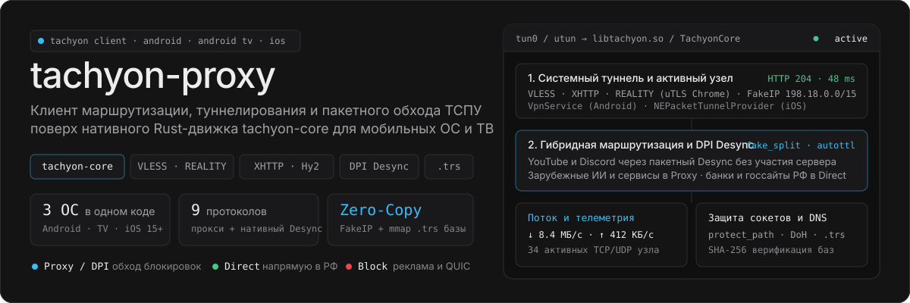
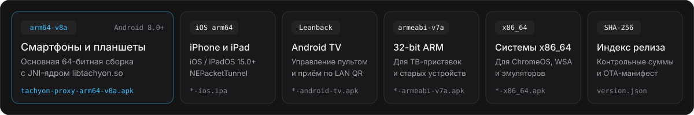
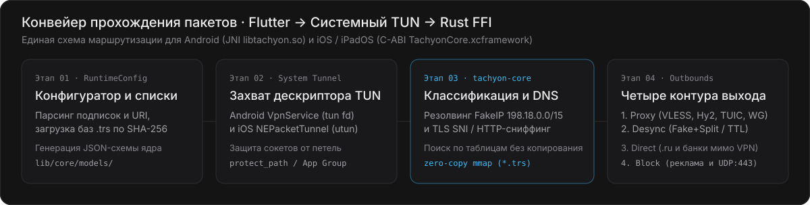
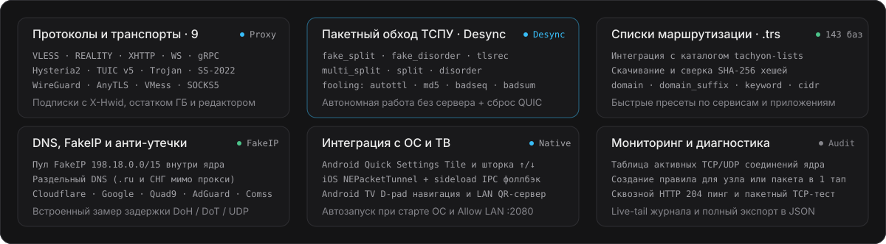

<p align="center">
  
</p>

<p align="center">
  <a href="https://github.com/Dushnilin/tachyon-proxy/actions/workflows/build.yml"></a>
  <a href="https://github.com/Dushnilin/tachyon-proxy/releases/tag/latest"></a>
  <a href="https://github.com/Dushnilin/tachyon-core"></a>
  <a href="https://github.com/Dushnilin/tachyon-lists"></a>
  
</p>

---

<p align="center">
  
</p>

<p align="center">
  
</p>

| Целевая платформа | Артефакт | Прямая ссылка (`releases/latest`) |
|:---|:---|:---|
| **Android (`64-bit ARM`, основной)** | `tachyon-proxy-arm64-v8a.apk` | `https://github.com/Dushnilin/tachyon-proxy/releases/download/latest/tachyon-proxy-arm64-v8a.apk` |
| **iOS / iPadOS 15.0+ (`arm64`)** | `tachyon-proxy-ios.ipa` | `https://github.com/Dushnilin/tachyon-proxy/releases/download/latest/tachyon-proxy-ios.ipa` |
| **Android TV / Google TV (`Leanback`)** | `tachyon-proxy-android-tv.apk` | `https://github.com/Dushnilin/tachyon-proxy/releases/download/latest/tachyon-proxy-android-tv.apk` |
| **Android (`32-bit ARM`, ТВ-боксы)** | `tachyon-proxy-armeabi-v7a.apk` | `https://github.com/Dushnilin/tachyon-proxy/releases/download/latest/tachyon-proxy-armeabi-v7a.apk` |
| **Android (`x86_64`, ChromeOS / WSA)** | `tachyon-proxy-x86_64.apk` | `https://github.com/Dushnilin/tachyon-proxy/releases/download/latest/tachyon-proxy-x86_64.apk` |
| **Универсальный APK (все ABI)** | `tachyon-proxy-universal.apk` | `https://github.com/Dushnilin/tachyon-proxy/releases/download/latest/tachyon-proxy-universal.apk` |
| **Манифест OTA и `SHA-256` суммы** | `version.json` · `SHA256SUMS.txt` | `https://github.com/Dushnilin/tachyon-proxy/releases/download/latest/SHA256SUMS.txt` |

<details>
<summary><b>Особенности установки на iOS / iPadOS (<code>.ipa</code>) и приставки Android TV</b></summary>

<br>

**Установка на iOS / iPadOS (`tachyon-proxy-ios.ipa`):**
- Пакет содержит основное приложение `Runner.app` и сетевое расширение `PacketTunnelExtension.appex` (`NEPacketTunnelProvider`), скомпилированные со статическим фреймворком `TachyonCore.xcframework`.
- В бинарные файлы предпрошиты права `com.apple.developer.networking.networkextension` (`packet-tunnel-provider`) и `com.apple.security.application-groups` (`group.app.tachyon.proxy`).
- При установке через **TrollStore** используются вшитые ad-hoc права без переподписи.
- При подписи через **SideStore**, **AltStore**, **Sideloadly**, **ESign** или **Feather** расширение автоматически переключается на передачу конфигурации, профилей и скачанных списков `.trs` через `NETunnelProviderProtocol.providerConfiguration` и IPC-сообщения `sendProviderMessage`, поэтому туннель работает даже без платного контейнера `App Group`.

**Установка на Android TV и медиаприставки (`tachyon-proxy-android-tv.apk`):**
- Отдельный пакет с `Leanback`-баннером для главного экрана Android TV / Google TV и поддержкой `arm64-v8a` + `armeabi-v7a`.
- Все элементы интерфейса адаптированы под навигацию крестовиной пульта (`D-pad` / `Enter` / `Back`).
- Для добавления подписок и `vless://` ключей без ввода текста с пульта встроен локальный HTTP-сервер с QR-кодом: смартфон в той же Wi-Fi сети сканирует код с экрана телевизора и отправляет ссылку напрямую в клиент.

</details>

---

<p align="center">
  
</p>

<p align="center">
  
</p>

<p align="center">
  <sub>Связанные репозитории экосистемы:
  <a href="https://github.com/Dushnilin/tachyon-core"><b>Dushnilin/tachyon-core</b></a> (нативное Rust-ядро маршрутизации и управления трафиком) ·
  <a href="https://github.com/Dushnilin/tachyon-lists"><b>Dushnilin/tachyon-lists</b></a> (компилятор бинарных баз <code>.trs v2</code> и <code>.srs v3</code>) ·
  <a href="https://github.com/Dushnilin/tachyon"><b>Dushnilin/tachyon</b></a> (клиент для роутеров OpenWrt)</sub>
</p>

<details>
<summary><b>Схема взаимодействия системного туннеля с <code>tachyon-core</code> и пример генерируемой конфигурации</b></summary>

<br>

Клиент не запускает дочерние процессы и не пересылает трафик через локальный SOCKS-прокси между слоями: файловый дескриптор системного интерфейса (`tun fd` на Android и `utun fd` на iOS) передаётся напрямую в Rust-ядро `tachyon-core` через FFI (`Java_org_tachyon_vpn_TachyonBridge_startCore` на Android и `tachyon_start(config_json, tun_fd)` на iOS).

Для предотвращения петель маршрутизации на Android поднимается локальный Unix-сокет `protect_path`, через который `tachyon-core` вызывает `VpnService.protect(fd)` для каждого исходящего сокета перед установкой соединения.

```json
{
  "log": { "level": "info" },
  "dns": {
    "servers": [
      { "tag": "dns-remote", "address": "https://1.1.1.1/dns-query", "detour": "proxy" },
      { "tag": "dns-direct", "address": "77.88.8.8", "detour": "direct" },
      { "tag": "dns-fakeip", "address": "fakeip" }
    ],
    "fakeip": {
      "enabled": true,
      "inet4_range": "198.18.0.0/15"
    }
  },
  "inbounds": [
    {
      "type": "tun",
      "tag": "tun-in",
      "Inet4Address": "172.19.0.1/30",
      "mtu": 1400,
      "auto_route": false,
      "sniff": true
    }
  ],
  "outbounds": [
    {
      "type": "vless",
      "tag": "proxy",
      "server": "edge.example.com",
      "server_port": 443,
      "uuid": "00000000-0000-0000-0000-000000000000",
      "tls": {
        "enabled": true,
        "server_name": "www.microsoft.com",
        "utls": { "enabled": true, "fingerprint": "chrome" },
        "reality": { "enabled": true, "public_key": "...", "short_id": "..." }
      },
      "transport": { "type": "xhttp", "path": "/api/v1/stream", "mode": "auto" }
    },
    {
      "type": "desync",
      "tag": "dpi",
      "strategy": "fake_split",
      "fooling": "autottl",
      "split_pos": 2,
      "drop_quic": true
    },
    { "type": "direct", "tag": "direct" },
    { "type": "block", "tag": "block" }
  ],
  "route": {
    "rule_set": [
      { "tag": "ru_whitelist", "type": "local", "format": "binary", "path": ".../rules/ru_whitelist.trs" },
      { "tag": "youtube", "type": "local", "format": "binary", "path": ".../rules/youtube.trs" },
      { "tag": "ai_all", "type": "local", "format": "binary", "path": ".../rules/ai_all.trs" }
    ],
    "rules": [
      { "rule_set": ["ru_whitelist"], "outbound": "direct" },
      { "rule_set": ["youtube"], "outbound": "dpi" },
      { "rule_set": ["ai_all"], "outbound": "proxy" }
    ],
    "auto_detect_interface": true,
    "protect_path": ".../protect_path"
  }
}
```

</details>

---

<p align="center">
  
</p>

<p align="center">
  
</p>

| Подсистема | Поддерживаемые механизмы и параметры |
|:---|:---|
| **Прокси-протоколы и транспорты** | `VLESS` (`Vision`, `REALITY`, `uTLS`), `Trojan`, `Shadowsocks` (`2022-blake3-*`, `aes-*-gcm`, `chacha20-ietf-poly1305`), `VMess`, `Hysteria2` (`Salamander`), `TUIC v5`, `AnyTLS`, `WireGuard`, `SOCKS5` · транспорты `TCP`, `XHTTP` (`splithttp`), `WebSocket`, `gRPC`, `HTTPUpgrade` |
| **Адаптивная сегментация пакетов (`Desync`)** | Локальное профилирование и сегментация TCP/UDP-потока без участия внешнего сервера: профили `auto`, `fake_split`, `fake_disorder`, `tlsrec`, `multi_split`, `split`, `disorder` · методы маркировки сегментов `autottl`, `md5`, `timestamp`, `badseq`, `badsum` · управление `UDP:443` (`QUIC`) и автоподбор оптимального профиля по целевым узлам |
| **Четыре режима работы туннеля** | **По правилам** (гибридное распределение `Proxy` + `Desync` + `Direct` + `Block`), **Локальный шейпинг (`Desync`)** (работает только локальный оптимизатор пакетов без VPN-сервера), **Весь трафик** (глобальный туннель с исключением национальных доменов РФ), **Исключения** |
| **Каталог [`tachyon-lists`](https://github.com/Dushnilin/tachyon-lists) (`.trs`)** | Встроенный менеджер 143 категорий правил в формате `TSRS v2` (`zero-copy mmap`), проверка контрольных сумм `SHA-256`, локальный кэш, поиск по доменам и пользовательские правила (`domain`, `domain_suffix`, `domain_keyword`, `ip_cidr`) |
| **Подписки и профили** | Парсинг ссылок, `Base64`-списков и `JSON`-аутбаундов, передача заголовка `X-Hwid`, учёт остатка трафика и срока действия из `Subscription-Userinfo`, пакетный TCP-пинг, автовыбор минимальной задержки и встроенный векторный генератор QR (`ISO/IEC 18004`) |
| **DNS и защита от утечек** | Виртуальный пул `FakeIP` (`198.18.0.0/15`), раздельный резолвинг национальных зон `.ru` / `.рф` / `.su` напрямую мимо туннеля, пресеты `DoH` / `DoT` / `UDP` резолверов (`Cloudflare`, `Google`, `Quad9`, `AdGuard`, `Comss`, `Яндекс`) со встроенным тестом отклика |
| **Раздельное туннелирование и мониторинг** | Поприложенческая маршрутизация на Android (`Proxy`, `Direct`, `DPI`), живой инспектор открытых `TCP`/`UDP` соединений ядра с созданием правил в один шаг, `live-tail` системного журнала и полный экспорт/импорт конфигурации в `JSON` |

---

<p align="center">
  
</p>

| Слой | Путь в репозитории | Назначение |
|:---|:---|:---|
| **Интерфейс и экраны** | [`lib/features/`](lib/features/), [`lib/app/`](lib/app/) | Экраны туннеля, профилей, правил и каталога `.trs`, настроек, приложений, DNS и инспектора активных соединений |
| **Контроллер и конфигуратор** | [`lib/core/app_controller.dart`](lib/core/app_controller.dart), [`lib/core/models/runtime_config.dart`](lib/core/models/runtime_config.dart) | Парсер подписок и URI, синхронизация с `tachyon-lists`, компиляция JSON-схемы `tachyon-core`, проверка обновлений |
| **Платформенный мост** | [`lib/core/services/core_bridge.dart`](lib/core/services/core_bridge.dart) | Асинхронный `MethodChannel` (`app.tachyon.proxy/vpn`) и поток событий `EventChannel` (`app.tachyon.proxy/events`) |
| **Android `VpnService`** | [`android/app/src/main/kotlin/org/tachyon/vpn/`](android/app/src/main/kotlin/org/tachyon/vpn/) | `TachyonVpnService`, `TachyonTileService`, `BootReceiver`, Unix-сервер `protectSocket`, JNI-обёртка `TachyonBridge` |
| **iOS `NEPacketTunnelProvider`** | [`ios/Runner/`](ios/Runner/), [`ios/PacketTunnelExtension/`](ios/PacketTunnelExtension/) | `PacketTunnelProvider` (`utun`), C-FFI заголовок `tachyon_core.h`, синхронизация через `App Group` и IPC `sendProviderMessage` |
| **Пайплайн CI/CD** | [`.github/workflows/build.yml`](.github/workflows/build.yml) | Автоматическая сборка Android APK (`ubuntu-latest`), iOS IPA (`macos-latest`) и публикация релизов с `SHA-256` |

<details>
<summary><b>Системные спецификации и команды локальной сборки (Android APK / iOS IPA)</b></summary>

<br>

| Параметр | Спецификация |
|:---|:---|
| **Идентификаторы пакетов** | `app.tachyon.tachyon_proxy` (Android) · `app.tachyon.tachyonProxy` и `.PacketTunnel` (iOS) |
| **Минимальные версии ОС** | Android 8.0 (`API 26`), Android TV / Google TV, iOS / iPadOS 15.0 |
| **Поддерживаемые архитектуры** | `arm64-v8a`, `armeabi-v7a`, `x86_64` (Android) · `arm64` (iOS) |
| **Бинарные артефакты ядра** | `libtachyon-arm64-v8a.so`, `libtachyon-armeabi-v7a.so`, `libtachyon-x86_64.so`, `TachyonCore.xcframework` |

**Сборка пакетов Android (`Linux` / `macOS` / `Windows`):**

```bash
# 1. Скачать JNI-библиотеки из последнего релиза Dushnilin/tachyon-core в android/app/src/main/jniLibs/<abi>/libtachyon.so
# 2. Проверить анализатор и модульные тесты
flutter analyze
flutter test

# 3. Собрать раздельные APK по архитектурам и сборку для Android TV
flutter build apk --release --split-per-abi
flutter build apk --release --dart-define=TACHYON_TV=true
```

**Сборка пакета iOS (`macOS` + `Xcode 15+`):**

```bash
# 1. Распаковать tachyon-core-ios-xcframework.tar.gz в ios/Frameworks/TachyonCore.xcframework
# 2. Собрать Flutter-часть и подписать Runner.app + PacketTunnelExtension.appex с вшитыми entitlements
flutter build ios --release --no-codesign
xcodebuild -project ios/Runner.xcodeproj -scheme Runner -configuration Release -sdk iphoneos \
  CODE_SIGN_IDENTITY="" CODE_SIGNING_REQUIRED=NO CODE_SIGNING_ALLOWED=NO
```

</details>

---

## Поддержать разработку

Если Tachyon помогает в работе, вы можете поддержать развитие проекта:

- **Boosty:** [boosty.to/tachyon](https://boosty.to/tachyon)
- **Карты РФ и СБП (CloudTips):** [pay.cloudtips.ru/p/449c5ef9](https://pay.cloudtips.ru/p/449c5ef9)
- **Bitcoin (BTC):** `bc1q9ehdv7y9g948jejyflkq7xmau3tytgunxgh35h`
- **Ethereum (ETH / ERC-20):** `0x6CB7a4547eD62EF64990D5C6B5D9fdA58EB223E6`
- **TON:** `UQDPhLRjMz5KltDLACAT3YXXHDVEtIDOHky2i33ZIOtsMEoR`
- **Solana (SOL):** `3csTGaNeU9KjhCKHEKAU3XLS5UfVjEeBVhXihpsETZwh`

---

## Правовая информация и отказ от ответственности

**Отказ от ответственности:**

1. **Назначение программного обеспечения.** `tachyon-proxy` (и встроенное ядро `tachyon-core`) является универсальным техническим средством маршрутизации сетевого трафика, балансировки нагрузки, диагностики сетевых соединений, обеспечения информационной безопасности и построения защищённых корпоративных и личных каналов связи (VPN).
2. **Соблюдение законодательства.** Программное обеспечение не создавалось, не предназначено и не распространяется для целей нарушения законодательства Российской Федерации (включая ФЗ № 149-ФЗ «Об информации, информационных технологиях и о защите информации») или законодательства любой иной юрисдикции, а равно для неправомерного получения доступа к информационным ресурсам, доступ к которым ограничен в соответствии с законом.
3. **Использование на собственный страх и риск.** Автор и правообладатель не предоставляют никаких прокси/VPN-серверов, узлов связи, подписок, ключей доступа или готовых списков маршрутизации. Программное обеспечение поставляется по принципу «КАК ЕСТЬ» (`AS IS`). Любая установка, настройка и эксплуатация программы осуществляются пользователем исключительно по собственной инициативе, на свой страх и риск и под свою полную единоличную ответственность. Правообладатель не несёт ответственности за действия пользователя, выбранные им конфигурации и любые последствия использования программного обеспечения.
